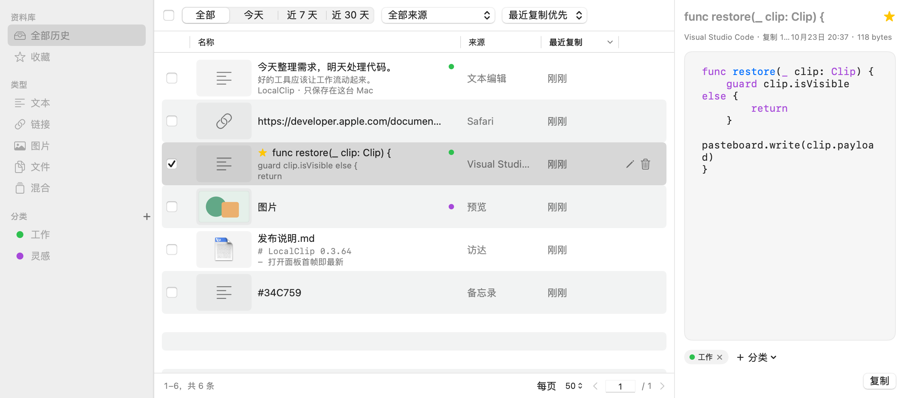

# LocalClip 📋✨

<p align="right">
  <a href="README_zh-CN.md"><b>简体中文</b></a> | <b>English</b>
</p>

<p align="center">
  
  
  
  
  
</p>

<p align="center">
  <b>A privacy-first, ultra-fast, native macOS clipboard manager inspired by Paste.</b>
</p>

---

### 🌟 Overview

**LocalClip** is a lightweight, high-performance clipboard management tool built natively for macOS (Apple Silicon). It brings the beloved, elegant horizontal card drawer UI (similar to Paste) to your desktop, while prioritizing **100% local privacy**, instant responsiveness, and seamless integration with macOS system workflows.

Whether you are copying plain text, rich formats (RTF/HTML), code snippets, high-resolution images, URLs, or Finder file objects, LocalClip handles them effortlessly with local clipboard processing and storage. Automatic updates can connect to GitHub and download signed packages; clipboard content is not sent.

---

### ✨ Key Features

#### 🔒 100% Local & Privacy-First
- **Local Clipboard Storage**: Clipboard records stay on your Mac. Optional automatic updates connect to GitHub; update requests do not send clipboard content.
- **Sensitive Data Filtering**: Automatically ignores transient and confidential items from password managers (1Password, Bitwarden, Apple Keychain, KeePassXC) marked with standard pasteboard concealment flags (`org.nspasteboard.ConcealedType`, `AutoGeneratedType`), plus apps you exclude in Settings.
- **Quota & Retention Rules**: Configurable storage limits (default 500 MiB) and retention periods (default 30 days). Expired ordinary items are purged automatically, while favorites and categorized items are strictly preserved.
- **Hide Contents & Sharing Restriction**: Hide clip text in the panel, previews and the queue panel while copy/paste keep working; optionally restrict system window sharing so screenshots, recordings and screen sharing usually can't see LocalClip windows.
- **On-Device Image Text Search (opt-in)**: Enable in Settings › Privacy to recognize text in copied images locally, then find an image by searching a phrase in it. Index existing images in the background, stop any time, and clear the index separately.

#### 🎨 Paste-Style Native Bottom Drawer UI
- **Docked to Screen Bottom**: Smooth horizontal drawer spanning the full width of your current monitor, adapting to Light and Dark modes. The first screen is prepared while the panel is hidden, so it opens straight to your latest copies.
- **Content-Aware Cards**:
  - **Text & Code**: Language detection that avoids misreading prose, paths and URLs as code, with syntax highlighting and hanging indentation. Rich text (RTF/HTML) keeps its original formatting.
  - **Images**: ImageIO thumbnails with pixel dimensions, with safe limits for giant images (>40 MP).
  - **Files**: Content-based previews (extension-less images, PDF/Office thumbnails, source files), "Show in Finder" and "Open With...".
  - **Links & Colors**: Domain badges for URLs; color values render as swatches.
- **Source-Colored Headers**: Each card header uses the source app's icon color, contrast-corrected to WCAG ≥ 4.5:1.
- **Toolbar**: **Clipboard (All)**, **Favorites**, type filters (Text, Link, Image, File, Mixed) and custom categories in one row. Single-click a custom category to switch, double-click to rename; ⌘-click to combine categories.
- **Preview & Detail**: `Space` previews the selection and follows arrow-key selection: images open a preview window (fit / actual size / zoom), files open a preview window showing text/code files with highlighting, other content opens the detail popover. `⌘I` shows the detail with recognized content and collapsible record info.

#### 🗂️ History Manager Window
- A separate three-pane window (sidebar / table / inspector) via the menu bar, `⌥⌘H`, the panel's "More" menu, or a card's "Show in History Manager".
- Page-by-page browsing, sorting, search and batch actions; drag one or many records onto a sidebar category to file them.
- Categories in the sidebar support rename and delete from the context menu. The bottom drawer hides while the manager is open.



#### 🪄 Smart Paste & Frictionless Workflow
- **Double-Click Direct Paste**: Single-click to select; double-click a card to restore its original formats and paste into the previously focused app. `Return` performs the default action (direct paste or copy only), `⇧Return` pastes plain text.
- **Quick Paste by Number**: Hold the quick-paste modifier (default `⌘`) to reveal number badges, then press `1`–`9` to paste that card from the current list.
- **Paste Queue**: Multi-select cards and choose "Add to Paste Queue"; each press of the queue shortcut (default `⌃⌥V`, active only while a queue runs) pastes the next item. A floating panel shows progress, the next item and failures; if direct paste is unavailable, the item is copied and waits for you to confirm a manual paste.
- **Transform & Paste**: `⌘T` converts text before pasting; hold `⌥` to copy instead of paste. The original record is never changed.
- **Content Editing**: `⌘E` edits text and link records in a bubble anchored to the card, with live syntax highlighting; `⌘S` / `⌘↩` saves, unsaved drafts are protected when switching away.
- **Smart Code File Pasting & Dragging (opt-in)**: Turn it on in Settings › Paste and add your editor apps to the list; pasting code files into those editors inserts the file's text, while Finder, unknown targets or read failures still get the file itself. Dragging code files out provides their text to editors. Images can be dragged straight into editors like Typora, Obsidian or VS Code.
- **Card Renaming**: Double-click the card title or press `⌘R` to give a clip a memorable name. `Enter` saves, `Esc` cancels, clearing the name restores the default.
- **Categories & Manual Ordering**: Drag cards into category tabs, or drag to reorder within All History or any category (multi-selection moves as a batch, with edge auto-scroll).
- **Search Syntax**: Search body text, custom names and source apps; filters accept quoted values with spaces, e.g. `in:"Project Alpha"`. Arrow keys move from the search field into results.
- **Inline Confirmations & Undo**: Destructive actions confirm in a small bubble pointing at the card or tab; deletions can be undone with `⌘Z`.

#### ⚡ Blazing Fast Performance
- **Swift 6.2 & Transactional SQLite**: Native AppKit + SwiftUI architecture. Every change is a single SQLite transaction with a rollback journal and full fsync, so a crash leaves either the complete old state or the complete new state. Saving a copy takes ~3 ms and stays flat as history grows.
- **Fast Queries**: Browsing pages in ~1 ms and literal search across Chinese phrases, code symbols, and URL fragments in ~10–30 ms for thousands of clips, with viewport-driven progressive loading.
- **Resilient Capture**: Monitoring resumes automatically on launch; stop it manually or for a set period. If the disk is temporarily full, LocalClip retries saving a few times and reports honestly if it still can't.

---

### 🖥️ Interface Preview

**Light Mode**


**Dark Mode**


---

### ⌨️ Keyboard Shortcuts & Gestures

| Action | Shortcut / Gesture | Description |
| :--- | :--- | :--- |
| **Toggle Drawer** | `⌥ + ⌘ + V` | Open or dismiss the history panel from anywhere (configurable) |
| **History Manager** | `⌥ + ⌘ + H` | Open the three-pane history manager window |
| **Navigate** | `←` / `→` or Scroll Wheel | Browse history horizontally |
| **Direct Paste** | `Double Click` (Card body) | Restore original formats and paste into the target app |
| **Paste** | `Return` / `⇧Return` | Run the default action (paste or copy only) / paste as plain text |
| **Quick Paste** | `⌘ + 1…9` | Paste the Nth card in the current list (modifier configurable) |
| **Copy to Board** | `⌘ + C` | Restore the selected item to the clipboard without pasting |
| **Preview** | `Space` | Toggle preview (images/files in a window, others in the detail popover); follows arrow keys |
| **Detail** | `⌘ + I` | Show the detail inspector |
| **Edit Content** | `⌘ + E` | Edit text/link content (`⌘S` / `⌘↩` to save) |
| **Transform & Paste** | `⌘ + T` | Convert, then paste (hold `⌥` to copy only) |
| **Rename Card** | `⌘ + R` / Double Click title | In-line rename (`Enter` commits, `Esc` cancels) |
| **Open / Locate** | `⌘ + O` / `⌘ + G` | Open the item / locate it in All History |
| **Switch / New Category** | `⌘⌥ + ←` `→` / `⌘⌥ + N` | Move between categories or create one (modifier configurable) |
| **Focus Search** | `⌘ + F` | Jump to the search field |
| **Paste Queue Next** | `⌃ + ⌥ + V` | Paste the next queued item (only while a queue runs) |
| **Undo Delete** | `⌘ + Z` | Restore the last deleted items |
| **Dismiss** | `Esc` / Click Outside | Step back: close confirmation/preview/detail, clear search, then close the panel |
| **Settings / Quit** | `⌘ + ,` / `⌘ + Q` | Open Settings / exit the app |

---

### 🛠️ Architecture & Tech Stack

```text
LocalClip/
├── LocalClipCore        # Pure Swift domain models, SQLite persistence, quota/retention engine
├── LocalClipMac         # Native pasteboard monitoring, Carbon hotkeys, AppKit/SwiftUI drawer & history manager
├── LocalClip            # AppKit lifecycle entry point and single-instance manager
├── LocalClipUpdateKit   # Signed update manifest, package verification and transactional install
└── LocalClipUpdater     # Helper that swaps in a downloaded update and relaunches
```

- **Frameworks**: Swift 6.2, SwiftPM, SwiftUI, AppKit, Combine, SQLite3, ImageIO, Vision.
- **Target OS**: macOS 15.0+ (Sequoia) on Apple Silicon (M1/M2/M3/M4).

---

### 🚀 Getting Started

#### Requirements
- macOS 15.0 or later
- Apple Silicon Mac
- Xcode 16+ / Command Line Tools with Swift 6.2

#### Build & Run
From the project root:

```bash
# Build the release application bundle (creates dist/LocalClip.app)
bash macos-app/scripts/build-app.sh release

# Open the built application
open macos-app/dist/LocalClip.app
```

> **Note**: For Direct Paste to work seamlessly, please grant **Accessibility** permissions to `LocalClip.app` in `System Settings -> Privacy & Security -> Accessibility`.

---

### 📄 License

This project is open source under the [MIT License](LICENSE).

### Update network behavior

Automatic update checks are enabled by default, run at startup/maintenance when due (at most once daily), and may download a signed update from GitHub. Disable automatic checks in Settings to prevent subsequent automatic checks and cancel background downloads. An already-running release-metadata request can finish; it will not start an automatic download after disabling the setting. Manual checks/downloads remain available. A downloaded package is installed only after **Install and Restart**. Clipboard processing/storage stays on this Mac; update requests do not send clipboard content.
