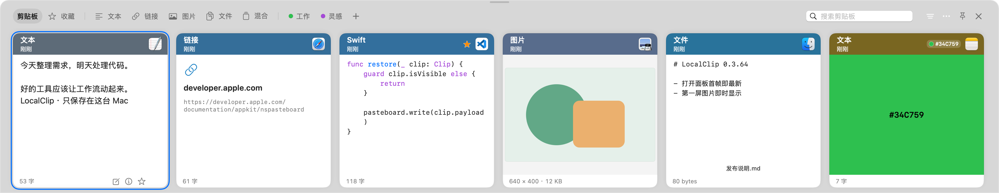
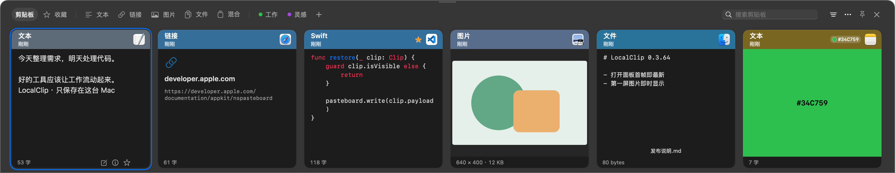

# LocalClip 📋✨

<p align="right">
  <b>简体中文</b> | <a href="README.md"><b>English</b></a>
</p>

<p align="center">
  
  
  
  
  
</p>

<p align="center">
  <b>原生、极致流畅、隐私优先的 macOS 底部卡片式剪贴板管理器（Paste 风格体验）。</b>
</p>

---

### 🌟 项目简介

**LocalClip** 是一款专为 macOS（Apple Silicon）打造的高性能、纯本地剪贴板管理工具。它带来了类似 Paste 优雅经典的**底部横向卡片抽屉**交互，同时严格坚持**100% 本地隐私**、毫秒级响应以及丝滑的原生系统契合度。

无论是纯文本、富文本 (RTF/HTML)、代码片段、高分辨率图片、网络链接，还是 Finder 真实文件对象，LocalClip 都能轻松记录与管理，剪贴板处理与存储均在本机；自动更新可连接 GitHub 检查和下载签名更新包，不发送剪贴板正文。

---

### ✨ 核心特性

#### 🔒 100% 纯本地与隐私优先
- **剪贴板本地存储**：所有剪贴记录仅保存在 Mac 本地 SQLite 数据库中，不上传剪贴板正文。自动更新会联网，可在设置中关闭。
- **敏感数据智能过滤**：自动识别并忽略密码管理器（如 1Password、Bitwarden、Apple 钥匙串、KeePassXC）带有敏感或临时标记的内容（`org.nspasteboard.ConcealedType`、`AutoGeneratedType` 等），也可在设置中排除指定应用。
- **空间配额与自动淘汰**：支持自定义历史保留期限（默认 30 天）和存储上限（默认 500 MiB）。到期或超出配额时自动清理普通记录，已收藏及已归入分类的记录受到严格保护不被淘汰。
- **隐藏内容**：可随时隐藏卡片内容；隐藏期间窗口不会在录屏或截图中露出内容。
- **本机图片文字搜索（默认关闭）**：在设置 › 隐私中开启后，本机识别之后复制的图片中的文字，搜索图中短语即可找到原图；已有图片可在后台建立索引，随时停止、下次继续，索引可单独清除。

#### 🎨 Paste 风格原生底部横向抽屉 UI
- **贴合屏幕底边**：展开时吸附在当前显示器底部全宽展示，适配浅色与深色外观。面板隐藏期间会预备好首屏，打开即是最新复制内容。
- **按内容自适应的卡片**：
  - **文本与代码**：统一的语言识别，减少把普通正文、路径和链接误判为代码；语法高亮与悬挂缩进排版。富文本（RTF/HTML）保留原始格式。
  - **图片**：ImageIO 高效缩略图并显示像素长宽，对超过 4000 万像素（40 MP）的超大图有内存保护。
  - **文件**：按真实内容预览（无后缀图片、PDF/Office 缩略图、源码文件），支持在 Finder 中显示及“打开方式…”。
  - **链接与色值**：链接显示域名标识，色值卡片直接铺色。
- **来源色卡片头**：卡片头部取来源应用图标主色，并按 WCAG 校正到对比度 ≥ 4.5:1。
- **单行工具栏**：**“剪贴板”（全部历史）**、**“收藏”**、**类型过滤（文本/链接/图片/文件/混合）**与**自定义分类**收归一行。自定义分类单击切换、双击改名，⌘ 点击可多选合并。
- **预览与详情**：`空格` 打开预览窗口，文本、图片（适应窗口/实际大小/缩放）与文件均可预览，并跟随方向键换选；`⌘I` 打开详情，显示识别结果，大小与格式等记录信息默认折叠。

#### 🗂️ 历史管理窗口
- 独立三栏窗口（侧栏 / 表格 / 检查器），可从菜单栏、`⌥⌘H`、面板“更多”或卡片右键“在历史管理中显示”打开。
- 按页码浏览、排序、搜索与批量管理；单条或多条记录可直接拖到侧栏分类中归类。
- 侧栏分类支持右键重命名与删除；打开管理窗口时底部面板自动收起。

#### 🪄 智能粘贴与高效交互
- **双击自动粘贴**：单击选择，**双击卡片正文**即恢复原格式并粘贴到唤起前的目标应用。`Return` 执行默认操作（直接粘贴或仅复制），`⇧Return` 粘贴纯文本。
- **数字快捷粘贴**：按住快捷粘贴修饰键（默认 `⌘`）显示数字角标，再按 `1`–`9` 粘贴对应卡片。
- **粘贴队列**：多选后右键“加入粘贴队列”，每按一次队列快捷键（默认 `⌃⌥V`，仅队列进行中生效）粘贴下一项。右下角浮窗显示进度、下一项摘要与失败原因；无法直接粘贴时先复制好当前项，等待确认手动粘贴后继续。
- **转换后粘贴**：`⌘T` 转换文本后再粘贴，按住 `⌥` 改为仅复制，原历史内容不变。
- **内容编辑**：`⌘E` 在贴靠卡片的气泡中编辑文本与链接记录，支持实时语法高亮；`⌘S` / `⌘↩` 保存，切换时保护未保存草稿。
- **代码文件智能粘贴与拖出**：把代码文件粘贴或拖到代码编辑器（VS Code、Xcode、Zed、终端等）时插入其代码文本，粘贴或拖到 Finder 仍是文件本身。图片可直接拖进 Typora、Obsidian、VS Code 等编辑器。
- **卡片重命名**：双击卡片标题或按 `⌘R` 为记录起一个易记的名字。`Enter` 保存，`Esc` 取消，清空名称即恢复默认。
- **分类与手动排序**：卡片可拖入分类标签归档，也可在全部历史或任一分类内拖放排序（多选整批移动，靠近边缘自动滚动）。
- **搜索语法**：按正文、自定义名称与来源应用检索；条件值可用引号包含空格，如 `in:"Project Alpha"`。搜索框中按方向键即可进入结果。
- **就地确认与撤销**：删除等操作在指向卡片或标签的小气泡中确认；删除后可用 `⌘Z` 撤销。

#### ⚡ 极致流畅的性能表现
- **Swift 6.2 + 事务式 SQLite**：纯原生 AppKit + SwiftUI 构建。每次变更都是一个带回滚日志与完整落盘的 SQLite 事务，崩溃后只会是完整旧态或完整新态；保存一次复制约 3 ms，且不随历史增大而变慢。
- **快速检索**：翻页约 1 ms；数千条历史中检索中文短词、代码符号与链接片段约 10–30 ms，并按可视区域渐进加载。
- **稳健记录**：启动后自动开始监控，可随时手动或定时停止监控；磁盘空间暂时不足时会稍后重试保存几次，仍失败会如实提示。

---

### 🖥️ 界面预览

**浅色模式**



**深色模式**



---

### ⌨️ 常用快捷键与交互操作

| 功能操作 | 快捷键 / 交互方式 | 说明 |
| :--- | :--- | :--- |
| **唤起 / 隐藏面板** | `⌥ + ⌘ + V` | 全局快捷键呼出底部历史面板（可自定义） |
| **历史管理** | `⌥ + ⌘ + H` | 打开三栏历史管理窗口 |
| **横向浏览** | `←` / `→` 或 触控板横向滚动 | 翻阅剪贴板历史卡片 |
| **直接粘贴** | `双击卡片正文` | 恢复原格式并粘贴到目标应用 |
| **粘贴** | `Return` / `⇧Return` | 执行默认操作（粘贴或仅复制）/ 粘贴纯文本 |
| **数字快捷粘贴** | `⌘ + 1…9` | 粘贴第 N 张可见卡片（修饰键可自定义） |
| **恢复至剪贴板** | `⌘ + C` | 仅写回系统剪贴板，不粘贴 |
| **预览** | `空格` | 开关预览窗口，跟随方向键换选 |
| **详情** | `⌘ + I` | 打开详情检查器 |
| **编辑内容** | `⌘ + E` | 编辑文本 / 链接内容（`⌘S` / `⌘↩` 保存） |
| **转换后粘贴** | `⌘ + T` | 转换后粘贴（按住 `⌥` 仅复制） |
| **重命名卡片** | `⌘ + R` / 双击标题 | 行内改名，`Enter` 保存，`Esc` 取消 |
| **打开 / 定位** | `⌘ + O` / `⌘ + G` | 打开记录 / 在全部历史中定位 |
| **切换 / 新建分类** | `⌘⇧ + ←` `→` / `⌘⇧ + N` | 在分类间切换或新建分类（修饰键可自定义） |
| **粘贴队列下一项** | `⌃ + ⌥ + V` | 粘贴队列中的下一项（仅队列进行中生效） |
| **撤销删除** | `⌘ + Z` | 恢复刚删除的记录 |
| **关闭** | `Esc` 或 单击外部区域 | 先清空搜索，再关闭面板 |
| **设置 / 退出** | `⌘ + ,` / `⌘ + Q` | 打开设置 / 退出应用 |

---

### 🛠️ 技术架构

```text
LocalClip/
├── LocalClipCore        # 纯 Swift 核心库：值类型契约、SQLite 存储引擎、原子事务与配额管理
├── LocalClipMac         # macOS 原生实现：剪贴板客户端、Carbon 热键、底部面板与历史管理窗口
├── LocalClip            # AppKit 应用入口与单实例生命周期控制
├── LocalClipUpdateKit   # 签名更新清单、安装包校验与事务式安装
└── LocalClipUpdater     # 独立安装器：替换已下载的更新并重启应用
```

- **开发语言与框架**：Swift 6.2、SwiftPM、AppKit、SwiftUI、Combine、SQLite3、ImageIO、Vision。
- **运行环境**：macOS 15.0+ (Sequoia)，适配 Apple Silicon (M系列芯片)。

---

### 🚀 快速上手

#### 系统要求
- macOS 15.0 (Sequoia) 或更高版本
- Apple Silicon (M1 / M2 / M3 / M4)
- Xcode 16+ 或已安装 Swift 6.2 的命令行工具

#### 构建与运行
在项目根目录下执行：

```bash
# 构建 Release 版本（产物输出至 macos-app/dist/LocalClip.app）
bash macos-app/scripts/build-app.sh release

# 打开应用
open macos-app/dist/LocalClip.app
```

> **提示**：为支持“双击直接粘贴”功能，请在系统的 **「系统设置」->「隐私与安全性」->「辅助功能」** 中授予 `LocalClip` 辅助功能权限。

---

### 📄 开源许可证

本项目基于 [MIT 许可证](LICENSE) 开源。

### 更新联网行为

默认开启自动检查，启动及维护时按每日最多一次的规则检查 GitHub，并可下载签名更新包。关闭自动检查后不再发起后续自动检查，并取消后台下载；已经在途的版本元数据请求仍可完成，但不会再启动自动下载。手动检查与下载仍可使用。已下载更新只在用户点击“安装并重启”后安装。更新请求不发送剪贴板正文。
