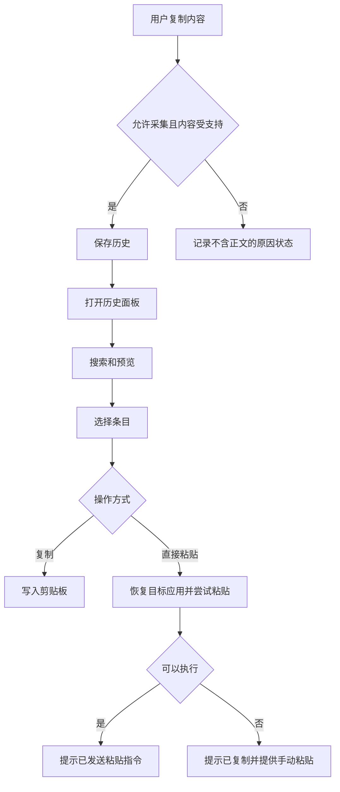
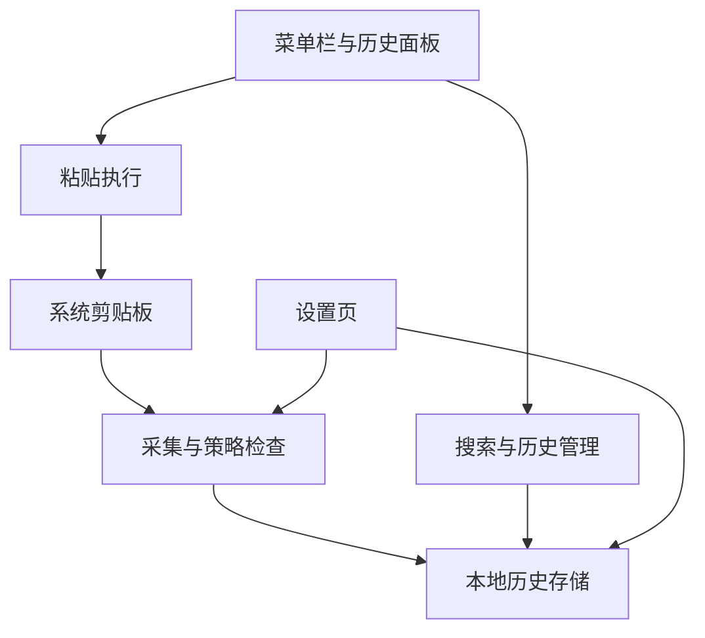
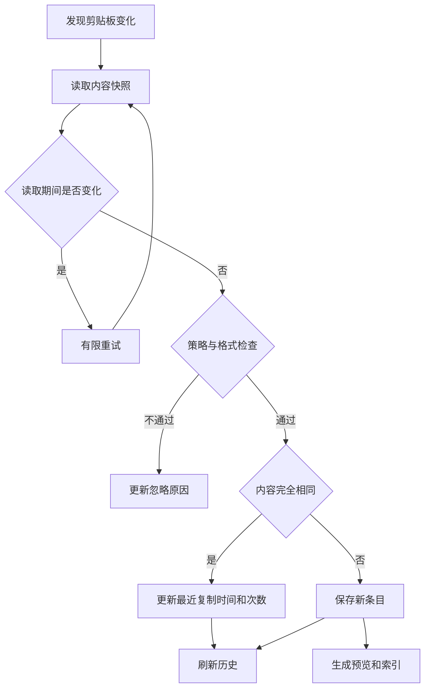
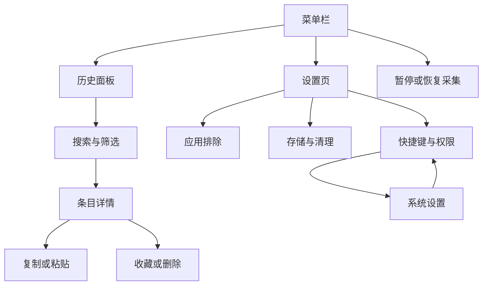

# PRD：macOS 剪贴板管理器｜本地首版｜2026-10-09

产品名称：待确定  
文档状态：待评审  
版本号、负责人、计划发布日期：待确定

文中的默认参数是建议方案，尚未经过产品评审或性能验证。REA 证据来自 [调查报告](REA-REPORT.md)，设计依据来自 [复刻方案](REPLICATION-PLAN-ZH.md)。

## 需求列表

| 应用 | 版本号 | 需求分类 | 变化内容 | 变化原因概括 | 可能风险 | 变更人 |
|---|---|---|---|---|---|---|
| macOS 剪贴板管理器 | 待确定 | 新增 | 采集、保存、检索、收藏与再次粘贴 | 系统剪贴板不能满足历史内容找回需求 | 多格式兼容、隐私过滤、目标应用粘贴差异 | 待填写 |

## 一、评审/变更记录

| 评审类型 | 评审时间 | 参与人员 | 评审问题反馈 |
|---|---|---|---|
| 技术方案预演 | 待安排 | 待填写 | 确认支持格式、系统版本、存储方案 |
| 产品内部对称 | 待安排 | 待填写 | 确认首版范围、默认设置与交互 |
| 需求评审 | 待安排 | 待填写 | 确认验收标准和发布条件 |
| 独立文档审查后修订 | 2026-10-09 | 独立审查代理、主代理 | 补齐容量、未知来源、期限与验收规则，移除首版用户标题检索承诺；不代表应用功能已验收 |

## 二、成本分析（非必填）

当前没有团队配置、技术验证结果和交付日期，暂不提供工期承诺。

工作拆分为五部分：

| 工作项 | 主要内容 | 估算前置条件 |
|---|---|---|
| 系统集成 | 剪贴板采集、快捷键、焦点与权限 | 验证目标 macOS 版本 |
| 数据管理 | 持久化、去重、搜索、清理 | 确认支持格式与容量规则 |
| 界面交互 | 面板、详情、设置、状态提示 | 确认交互原型 |
| 行为测试 | 多格式、重启、异常与目标应用 | 明确支持应用矩阵 |
| 发布准备 | 打包、升级与数据迁移 | 确定分发方式 |

首版不包含云端服务建设、OCR、AI 或团队共享。

## 三、需求分析

### 3.1 需求描述

#### （1）需求背景

目标用户为经常在多个应用间复制文本、链接、代码和图片的 macOS 用户。

典型问题包括：

- 新复制的内容覆盖旧内容，必须返回原应用重新查找。
- 历史内容较多时，中文短词、代码和链接不容易检索。
- 重新粘贴时，格式、权限或焦点变化导致结果不符合预期。
- 用户不清楚哪些内容会被保存，以及为什么某次复制没有被记录。
- 图片等内容长期积累，造成不透明的磁盘占用。

以上属于基于使用流程提出的产品假设，尚未经过独立用户调研。

#### （2）现状说明

REA 调查确认，Paste 安装包包含：

- macOS 原生剪贴板接口引用。
- Core Data 历史、内容、来源应用、设备和列表模型。
- 校验值、时间、标题与原始剪贴板数据字段。
- 辅助功能检查和键盘事件接口。
- CloudKit 同步相关结构。

未确认其完整源码、去重算法、搜索排序、同步冲突规则及所有目标应用中的粘贴效果。

本产品独立定义上述规则，不把未验证的原版行为作为验收依据。

#### （3）需求目标

首版完成以下闭环：

> 复制内容后保存 → 打开历史 → 搜索和确认 → 再次复制或粘贴。

目标包括：

1. 支持文本、URL、图片及限定富文本。
2. 历史记录退出重启后仍可使用。
3. 中文短词、英文、代码符号和 URL 片段可检索。
4. 自动粘贴失败时保留手动粘贴路径。
5. 采集状态和忽略原因可解释。
6. 保留期限、容量及删除行为明确。

#### （4）需求价值

- 减少重复查找和重新复制。
- 提高中文、代码和链接内容的找回效率。
- 降低误选、误粘贴和格式损失。
- 让用户理解并控制本机保存的数据。
- 为后续同步建立可靠的本地数据基础。

### 3.2 用户调研记录（非必填）

| 调研对象 | 调研人员 | 需求描述 | 痛点分析 |
|---|---|---|---|
| 本次需求提出者 | 未开展独立调研 | 基于 Paste 报告形成可复刻的产品方案 | 需要明确范围、行为及改进方向 |
| 后续目标用户 | 待填写 | 待调研 | 验证实际使用频率和优先级 |

### 3.3 典型使用场景（非必填）

#### （1）场景缩略图

| 什么人 WHO | 什么时间/什么情况 WHEN | 什么地点、前置 WHERE | 发生了什么 What | 心情怎样 HOW | 他想做什么（目标） |
|---|---|---|---|---|---|
| 开发者 | 连续复制代码与错误信息后 | 编辑器和浏览器之间 | 需要之前的一段代码 | 不愿重复查找 | 搜索并恢复代码 |
| 文档用户 | 编辑材料时 | 浏览器和办公软件之间 | 需要之前复制的段落或图片 | 担心格式丢失 | 确认预览后粘贴 |
| 隐私敏感用户 | 使用敏感应用时 | 已开启历史记录 | 不希望相关内容落盘 | 需要明确控制 | 排除应用或暂停采集 |

| 业务场景分析 | 内容 | 补充 | 说明 |
|---|---|---|---|
| 任务名称 | 找回历史内容 | — | 首版核心任务 |
| 任务简述 | 检索并恢复之前复制的内容 | — | 支持复制和直接粘贴 |
| 任务前提 | 内容已成功采集 | — | 被过滤内容不可找回 |
| 任务频率 | 待调研 | — | 不预设真实频率 |
| 角色 | 流程 | 任务与问题 | 期望需求 |
| 用户 | 搜索、预览、选择 | 匹配内容多，容易选错 | 命中上下文和清晰反馈 |

| 角色 | 期望需求 | 实际需求 | 解决方式 |
|---|---|---|---|
| 用户 | 快速找回旧内容 | 找对内容并恢复格式 | 搜索、预览、原格式及纯文本操作 |

#### （2）需求流程图

### 3.4 竞品分析（非必填）

本轮仅以 Paste 为已调查参照，不扩大竞品结论。

| 参照点 | 可借鉴内容 | 本产品要求 |
|---|---|---|
| 历史内容结构 | 原始内容与元数据分开保存 | 不只保存展示文本 |
| 搜索与组织 | 历史检索、列表管理 | 首版实现搜索和收藏 |
| 直接粘贴 | 系统集成 | 明确失败反馈与回退 |
| 云同步 | 专门的同步结构 | 后续独立阶段建设 |

改进方向是本产品的设计目标，不代表已经证明 Paste 缺少相应能力。

## 四、方案设计

首版采用菜单栏入口、全局快捷键和历史面板，数据保存在本机。

**首版包含：**

- 文本、URL、图片、限定富文本。
- 历史浏览、搜索、详情预览。
- 原格式复制、纯文本复制、直接粘贴。
- 收藏、单条删除、清空普通历史。
- 暂停采集、应用排除、保留期限与容量控制。
- 本地状态和错误反馈。

**后续阶段：**

- 多分类、连续粘贴队列。
- 文件引用、导入导出。
- 云同步和共享。
- OCR、语义搜索、AI/MCP。

技术方向建议 Swift、AppKit、SwiftUI；存储采用 SQLite 或 Core Data，技术评审确定一种。搜索和缩略图均为可重建数据。

资源与时间可行性需要通过多格式采集、目标应用粘贴和性能原型验证后评估。

## 五、概要设计

### 5.1 名词定义（非必填）

| 名词 | 描述 |
|---|---|
| 历史条目 | 一次有效采集形成的内容记录 |
| 原格式 | 已支持并保存的原始内容格式，不承诺所有私有格式 |
| 纯文本 | 从条目中提取的无格式文本 |
| 收藏 | 用户明确保留的条目 |
| 自身写入 | 本应用将历史内容重新写入剪贴板 |
| 忽略原因 | 未保存内容的原因，不包含被忽略的正文 |

### 5.2 业务逻辑说明

业务框架：

业务流程：

重试达到上限后终止本次采集并显示原因，不无限等待。

### 5.3 功能清单

| 编号 | 形态 | 功能模块 | 功能点 | 优先级 | 备注 |
|---|---|---|---|---|---|
| F01 | 运行态 | 采集 | 文本、URL、图片、限定富文本 | P0 | 保留支持的格式 |
| F02 | 运行态 | 存储 | 持久化与精确去重 | P0 | 重启可恢复 |
| F03 | 运行态 | 历史 | 浏览、详情、键盘导航 | P0 | 避免加载全部图片 |
| F04 | 运行态 | 搜索 | 中文短词、代码、URL 字面检索 | P0 | 不把输入作为查询语法 |
| F05 | 运行态 | 恢复 | 原格式和纯文本复制 | P0 | 不生成重复历史 |
| F06 | 运行态 | 粘贴 | 直接粘贴与手动回退 | P0 | 不虚报接收成功 |
| F07 | 配置态 | 隐私 | 排除应用、敏感标记过滤 | P0 | 先过滤后落盘 |
| F08 | 配置态/运行态 | 状态 | 暂停、恢复与原因提示 | P0 | 暂停期间不补采 |
| F09 | 运行态 | 收藏 | 收藏与取消收藏 | P0 | 不受普通期限清理 |
| F10 | 配置态/运行态 | 清理 | 期限、容量、删除 | P0 | 派生数据一致处理 |
| F11 | 配置态 | 设置 | 快捷键、粘贴模式、启动行为 | P0 | 冲突可反馈 |
| F12 | 运行态 | 组织 | 多分类、连续粘贴 | P1 | 后续 |
| F13 | 配置态/运行态 | 同步 | 云同步与每项范围 | P1 | 后续独立验收 |
| F14 | 运行态 | 智能能力 | OCR、语义检索、AI | P2 | 后续 |

### 5.4 影响范围

（1）产品版本兼容

| 版本 | 支持情况 | 备注 |
|---|---|---|
| A6 | 不适用 | 本产品为独立 macOS 应用 |
| A8 | 不适用 | 不涉及 OA 版本 |
| A8-N | 不适用 | 不涉及 OA 版本 |

（2）终端兼容

| 终端 | 支持情况 | 备注 |
|---|---|---|
| 电脑端 | 支持 macOS | 最低系统版本、芯片范围待技术评审 |
| 移动端 | 首版不支持 | 后续另行规划 |
| H5 | 不支持 | 无网页客户端 |

（3）业务包版本兼容

| PC端版本 | 备注 |
|---|---|
| 低版本 | 首次发布无历史版本；后续升级需定义迁移规则 |
| 低版本升级 | 迁移失败不得覆盖原数据 |
| 高版本 | 未验证的数据降级不得直接写入 |

| 移动端版本 | 备注 |
|---|---|
| 低版本 | 首版不适用 |
| 低版本升级 | 首版不适用 |
| 高版本 | 首版不适用 |

（4）已有功能兼容

| 场景 | 处理方式 |
|---|---|
| 系统剪贴板正常复制 | 采集失败不应主动替换内容 |
| 其他剪贴板工具同时运行 | 防止自身写入循环；联测实际冲突 |
| 权限未授予 | 保留可用的手动复制与粘贴路径 |
| 不支持的内容格式 | 显示限制，不承诺完整恢复 |

### 5.5 非功能性指标（非必填）

性能指标：

| 指标 | 要求说明 |
|---|---|
| 响应速度 | 待验证目标：面板打开 P95＜150ms；搜索 P95＜100ms；复制到可见 P95＜500ms |
| 用户承载量 | 单机单用户；基准数据为一万条文本及代表性图片 |
| 资源占用 | 记录空闲 CPU、功耗、峰值内存与大图耗时；阈值待原型测试 |
| 测试条件 | 固定硬件、系统、数据集和测量方法 |

安全需求：

| 要求说明 |
|---|
| 首版不上传剪贴板内容 |
| 被过滤内容不进入正文、附件、预览、索引或日志 |
| 日志不记录正文、图片、完整 URL 和搜索词 |
| 本地保存不宣称已加密；加密方案另行评审 |
| 删除后内容不可继续被搜索或预览 |

兼容性要求：

| 指标 | 要求说明 |
|---|---|
| 客户端 | 明确发布支持的 macOS 与目标应用矩阵 |
| WEB端 | 不适用 |

数据埋点：

首版仅保留必要的本机诊断，不建设外部分析服务。

| 触发条件 | 埋点事件 | 埋点参数 | 涉及终端 |
|---|---|---|---|
| 采集结束 | capture_result | 成功、失败原因、类型、耗时 | macOS |
| 检索结束 | search_result | 耗时、结果数量；不含搜索词 | macOS |
| 执行粘贴 | paste_action | 模式、指令状态、回退原因 | macOS |
| 执行清理 | cleanup_result | 条目数、释放容量、失败数 | macOS |

### 5.6 风险分析（非必填）

| 风险类型 | 风险描述 | 影响程度 | 应对措施 |
|---|---|---|---|
| 技术风险 | 连续快速复制可能漏采 | 高 | 稳定快照、有限重试、压力测试；不承诺任意速度零丢失 |
| 技术风险 | 目标应用不接受格式或粘贴事件 | 高 | 支持矩阵、实际结果检查、手动回退 |
| 隐私风险 | 敏感内容没有识别标记 | 高 | 应用排除、暂停、明确检测边界 |
| 数据风险 | 清理或保存中断造成不一致 | 高 | 事务、恢复检查和附件回收 |
| 业务风险 | 首版扩展过多 | 中 | 同步、OCR、AI 分阶段实施 |
| 时间风险 | 尚未完成原型验证 | 中 | 验证后再承诺工期 |

## 六、详细设计

### 6.1 通用规则说明

- 默认开启本地采集；首次说明保存范围和关闭方式。
- 默认不自动登录启动，由用户主动开启。
- 默认操作为复制；直接粘贴由用户启用。
- 建议普通历史保留 30 天、历史存储容量上限 500MiB，均可修改；具体上下限待评审。期限按最近一次有效用户复制时间计算，一天按连续 24 小时计算；距该时间达到保留期限即到期。
- 收藏不参与普通期限和自动淘汰，但仍计入容量。
- 每次保存前检查预计新增占用；能够容纳时，按最近复制时间从早到晚淘汰必要的普通条目。即使淘汰全部普通条目仍无法容纳时，跳过新内容并提示，不为这次采集删除已有条目；收藏不得自动淘汰。
- 超大内容按明确限制跳过；阈值待格式测试，不隐性截断。
- 完全相同内容再次复制，更新最近时间和次数，保留收藏状态，并从这次复制重新计算保留期限。历史面板浏览和自身写入不刷新该时间。
- 可见文字相同但格式不同，不按纯文本强制合并。
- 自身写入不新增历史；用户随后复制的新内容仍正常记录。
- 已存在的历史不因新增排除规则自动删除，用户可以单独清理。
- 暂停期间不保存、不补采；恢复后从新的变化开始。
- 磁盘不足或保存失败不得显示为已记录。
- 来源未知时，在通过暂停、访问、敏感标记、格式及容量检查后默认保存，来源显示“未知”；应用排除只对可靠识别的来源生效，设置页明确说明这一边界。

### 6.2 页面流程图

### 6.3 方案详细设计

#### （1）菜单栏与采集状态

**入口：**菜单栏图标。

展示打开历史、暂停/恢复、设置、退出，以及当前采集状态。

状态分为：正常、用户暂停、访问受限、容量已满、存储异常。

最近忽略原因只显示类别与时间，不显示被忽略内容。来源无法可靠判断时标记未知，不伪造应用名称。

#### （2）历史面板

**入口：**菜单栏或用户配置的全局快捷键。

布局包含搜索栏、全部/收藏切换、类型筛选、历史列表和状态提示。

卡片展示内容摘要或缩略图、来源应用、最近复制时间、内容类型与收藏状态。

- 默认按最近复制时间排序。
- 方向键移动选择，Escape 关闭。
- Enter 执行当前配置的默认操作。
- 打开面板时记住目标应用。
- 搜索无结果、历史为空和加载失败分别展示。
- 异步查询不得用旧结果覆盖用户最新输入。

#### （3）搜索

支持正文、URL 和来源名称检索。首版不提供用户自定义标题及其检索。

- 输入按字面内容处理，代码符号不会触发查询语法错误。
- 两字中文词必须有有效检索路径。
- 默认英文检索不区分大小写，保留符号和数字。
- 先按匹配程度，再按最近复制时间排序。
- 收藏范围内只检索收藏。
- 结果展示匹配上下文。

首版不包含 OCR 和语义检索。

#### （4）详情与格式恢复

详情展示完整文本、图片预览、来源、时间、内容大小及可恢复格式。

支持原格式复制、纯文本复制、直接粘贴、收藏和删除。

- 图片没有文本时，纯文本操作不可用并说明原因。
- 不支持的格式不得显示为完整支持。
- 恢复内容保留已支持的多项顺序。
- 缩略图生成失败不阻止有效原始内容的复制。

#### （5）直接粘贴

启用时解释辅助功能权限用途，并提供系统设置入口。

执行前检查目标应用与权限。将内容写入剪贴板后返回打开面板前记录的目标应用；确认其处于前台后才尝试发送粘贴指令。不能将执行时恰好位于前台的另一个应用作为替代目标。

目标已退出、激活失败或在发送前发现前台已切换到其他应用时，停止发送并回退为手动粘贴，不反复抢回焦点。首版只恢复目标应用，不保证恢复该应用内原来的输入框或光标位置；验收覆盖发送前能检测到的焦点变化，不能以事件已发送推断接收位置正确。

提示用语：

| 情况 | 提示 |
|---|---|
| 复制完成 | 已复制到剪贴板 |
| 指令发送完成 | 已发送粘贴指令 |
| 缺少权限 | 已复制，请在目标应用手动粘贴 |
| 目标已退出或不可用 | 已复制，请选择目标应用后粘贴 |
| 激活失败或检测到目标焦点变化 | 已复制，请确认目标位置后手动粘贴 |
| 剪贴板写入失败 | 复制失败，请重试 |

未经目标结果验证，不显示“已成功粘贴”。

#### （6）应用排除与敏感内容

设置页支持添加和移除排除应用。

匹配可靠来源后，被排除内容不持久化，也不生成派生数据。

- 首版至少识别 `org.nspasteboard.ConcealedType` 和 `org.nspasteboard.TransientType`；任一项目包含其中一种标记时，整次复制均跳过，不保存其他未标记项目。这是本产品的过滤规则，不代表所有来源应用都会提供这些标记。
- 不宣称可以识别所有密码。
- 来源未知且未命中其他过滤条件时默认保存并显示“未知”。设置页说明：“无法识别来源的内容仍会记录，应用排除不覆盖未知来源；需要停止记录时请暂停采集。”未知来源不能绕过敏感或临时标记过滤。
- 移除排除不会补采过去内容。

#### （7）收藏、容量与删除

收藏切换立即保存，重启后保持。取消收藏不改变最近复制时间；若内容已到期，操作前提示“取消收藏后将按保留规则删除”，用户确认后取消收藏并清理，取消操作则保持收藏和内容。

存储页展示历史存储总占用、普通条目和收藏内容占用，以及索引等公共占用、待回收占用，提供期限、容量设置与清理入口。

**容量规则：**

- 上限按历史存储文件的实际字节数统计，包括数据库及其日志文件、原始载荷、搜索索引、缩略图和已删除但尚未回收的文件；应用程序本体、诊断日志及写入期间的临时文件不计入该上限，后者仍需检查可用磁盘空间。
- 共享载荷只计一次；同时被收藏与普通条目引用时，其占用归入收藏，不作为删除普通条目可释放的空间。公共索引等不重复摊入条目占用。
- 保存前估算新内容及必要元数据的占用，并核对实际可释放空间。若淘汰所有普通条目仍不足，拒绝本次采集，保留已有条目。收藏恰好占满只是这一规则的一个特例。
- 先确认新内容能够持久化，再一致地完成新条目发布和必要淘汰；新内容保存失败时，不得使为其选中的普通条目丢失。对已到期内容的正常期限清理独立执行。
- 延后回收的数据在实际释放前仍计入占用；回收失败不能显示为已释放。异步缩略图或索引生成也必须检查剩余额度，可释放可重建缓存；仍不足时保留原始内容、延后派生内容生成，不为此额外删除用户条目。索引不可用时仍需提供正文的字面检索路径。
- 用户下调上限导致超额时，先展示预计淘汰数量并确认。确认后清理普通条目；若收藏和不可释放部分仍超额，保留它们并暂停新增采集，直到释放容量或上调上限。

**期限规则：**

- 启动和从系统休眠恢复时先检查到期内容；运行期间每分钟检查，保存或修改期限后也触发检查。到期内容在清理完成前也不得继续出现在列表、搜索或详情中。
- 期限修改前提示预计删除数量，确认后立即按新期限处理普通条目；收藏保持不变。
- 容量淘汰按最近复制时间从早到晚执行，相同时间以首次采集时间、条目 ID 依次确定稳定顺序。

**删除规则：**

- 单条删除后立即从列表、搜索和详情移除。
- 清空普通历史需要确认，并保留收藏。
- 清空全部内容明确说明包含收藏。
- 共享载荷仍被其他有效条目引用时，不直接删除。
- 删除失败显示失败状态，不能虚报全部完成。
- 后台文件回收可以延后，但已删除内容不可继续访问。

#### （8）设置与管理

首版没有独立管理后台，所有管理入口位于本机设置页。

设置包含：

- 采集开关与暂停。
- 开机启动。
- 全局快捷键及冲突提示。
- 默认复制/直接粘贴模式。
- 应用排除。
- 保留期限、容量与清理。
- 权限状态。
- 不含内容的诊断信息。

快捷键注册失败时保留菜单栏入口，不能让用户失去访问应用的方式。

#### （9）首版验收标准

| 编号 | 场景与操作 | 通过标准 |
|---|---|---|
| AC01 | 连续复制 A、B、C，并等待各项可见 | 三条均可检索，顺序正确 |
| AC02 | 退出重启 | 内容、收藏和设置恢复 |
| AC03 | 再次复制完全相同内容 | 更新最近时间，不重复新增 |
| AC04 | 相同文字、不同支持格式 | 不因纯文本相同错误合并 |
| AC05 | 搜索两字中文、代码符号和 URL 片段 | 返回正确结果，无语法错误 |
| AC06 | 从历史复制文本和图片 | 实际目标应用得到正确内容 |
| AC07 | 在支持矩阵中执行直接粘贴 | 检查实际结果及格式 |
| AC08 | 关闭权限或退出目标应用 | 有明确提示，手动回退可用 |
| AC09 | 恢复历史后立即复制新内容 | 不重复记录自身写入，也不漏掉新内容 |
| AC10 | 在可靠识别的排除应用中复制 | 内容不进入正文、附件、索引、预览和日志 |
| AC11 | 暂停后复制，随后恢复 | 暂停内容不补采；新复制正常保存 |
| AC12 | 期限或容量触发清理 | 普通内容按规则清理，收藏保留 |
| AC13 | 收藏占满容量 | 停止保存并提示，不静默删除收藏 |
| AC14 | 删除条目 | 无法再检索或预览，关联数据按引用关系处理 |
| AC15 | 模拟保存失败和磁盘不足 | 不显示采集成功，已有数据可用 |
| AC16 | 基准数据性能测试 | 报告实际 P95、资源占用和未达标项 |
| AC17 | 上限 500MiB；收藏及不可释放部分 490MiB、可释放普通内容 5MiB；新内容连同必要元数据预计增加 20MiB | 拒绝本次采集并提示空间不足；不为该次采集淘汰已有内容，不超额保存；本用例已有条目均未到期 |
| AC18 | 来源未知，内容受支持且无过滤标记、空间充足；再复制相同条件但带敏感或临时标记的内容 | 前者保存并显示“未知”；后者不进入正文、附件、索引、预览或日志；排除设置可见未知来源说明 |
| AC19 | 保留 30 天；首次复制于 31 天前、最近复制为今天；另有最近复制已满 30 天的普通条目 | 前者保留，后者到期不可检索；重新复制更新期限，仅浏览或从历史恢复内容不延长期限 |
| AC20 | 取消收藏一个最近复制已满保留期限的条目 | 操作前提示将删除；取消则保持收藏及内容，确认则取消收藏并清理；未到期条目取消收藏后保留 |
| AC21 | 在支持矩阵中的富文本目标内，分别以原格式和纯文本复制同一段包含加粗及换行的内容，再手动粘贴 | 原格式保留已声明支持的加粗与换行；纯文本字符及换行一致、不携带加粗格式；纯文本结果以目标的默认格式显示 |
| AC22 | 从非排除来源复制分别带 ConcealedType、TransientType 的测试内容，以及只有部分项目带标记的多项内容 | 三种情况均跳过整次复制；无正文、附件、索引、缩略图或日志正文残留，只允许不含内容的原因状态 |
| AC23 | 设置已被占用的全局快捷键，使注册失败 | 显示冲突，仍可从菜单栏打开历史并复制内容；改为可用快捷键后可正常打开 |
| AC24 | 从应用 A 打开面板，分别制造 A 退出、激活失败和发送前检测到前台切为 B | 不向 B 发送粘贴事件，不反复抢焦点；内容在剪贴板，提示手动粘贴；正常返回 A 的场景单独检查实际结果 |
| AC25 | 构造共享载荷、索引、缩略图和待回收文件；执行删除并模拟回收失败、异步派生额度不足 | 总占用按规则计算且共享载荷不重复；回收失败不虚报释放；额度不足不追加派生数据或删除原始条目，正文仍可搜索 |
| AC26 | 模拟需要淘汰普通内容才能保存的新条目，在新内容持久化时注入失败 | 本次不新增成功记录，为本次采集选中的未到期普通条目保持可用，收藏保持；提示失败 |
| AC27 | 缩短保留期限或降低容量上限，分别取消和确认操作；降低上限后收藏仍超额 | 取消不修改规则或内容；确认按预览执行，收藏不自动删除；剩余超额时暂停新增，释放容量或上调上限后恢复 |

验收前置条件：技术评审确定最低 macOS 版本、芯片范围、具体支持格式、目标应用矩阵和单条大小限制；格式清单逐项说明保留哪些表现、哪些表现允许降级。AC04、AC06、AC07、AC21 必须依据该清单执行，不能以“限定富文本”代替测试范围。

发布条件：所有 P0 行为通过验收；支持系统与目标应用矩阵明确；没有未解决的数据丢失或隐私过滤严重问题。未执行的测试不得标记通过。本轮文档修订及独立复核均不代表应用测试通过。
