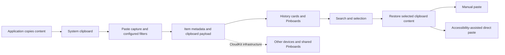

# How Paste works — REA investigation

Date: 9 October 2026, Asia/Singapore. Target: `/Applications/Paste.app`, version **6.0.3**, build **14117**. Analysis used the connected **REA 6.0.0 MCP server**. This report supersedes the earlier report for binary and package findings; earlier screenshots remain separately labeled supporting evidence.

Paste turns the single system clipboard into reusable history. The evidence supports a native clipboard interface, a Core Data store that separates metadata from clipboard payloads, source-app/device/Pinboard relationships, CloudKit synchronization infrastructure, and accessibility-assisted direct paste. REA also decoded the shipped Stack UI and identified its controls. Exact capture timing, search ranking, deduplication, and executed function paths remain unresolved because no native decompiler is available.

## Target identity and evidence boundary

REA opened the app's main executable and bound its SHA-256:

```text
/Applications/Paste.app/Contents/MacOS/Paste
e0b96d48ee4027dccacded16dd3c738878496ef005b913580b34bfc89d31b2e7
```

The executable contains **x86_64 and arm64** slices. The parsed Info.plist reports identifier `com.wiheads.paste`, minimum macOS 13.0, `LSUIElement=true`, and `NSSupportsAutomaticTermination=false`. These declarations explain the intended menu-bar/background application shape; they do not prove uninterrupted runtime capture. [REA Info.plist evidence](evidence/rea-plist.json), [Mach-O evidence](evidence/rea-macho.json)

The package inventory has 92 content-addressed nodes and 94 occurrences. Its manifest is `agm_5da7ad2a02a33d1608ea2483c1e75b68c9620f51c735e732cfc1901b15190aca`. Inventory coverage is complete within the inventory substep, not a claim of complete behavioral analysis. [REA artifact inventory](evidence/rea-inventory.json)

## The working flow



The sequence combines package observations, serialized data relationships, earlier UI evidence, and documented product behavior. It is an explanatory model, not a recovered call graph.

| Step | What the evidence shows | What remains unknown |
|---|---|---|
| Capture | Main binary imports `NSPasteboard`, `NSPasteboardItem`, and `NSPasteboardTypeString`; saved preferences include a pasteboard change token | Polling/event mechanism, interval, rapid-copy loss behavior |
| Filtering | Packaged settings describe confidential/transient filtering and app exclusions; current preferences exclude Passwords and Keychain Access | Exact sensitive-content detection and all supported pasteboard markers |
| Persistence | A shipped Core Data model has item, payload, app, device, list, and synchronization entities; its hashes match the local database | Payload encoding, compression policy, write latency, encryption |
| Retrieval | Item title is marked for Spotlight indexing; binary imports Core Spotlight query/index classes; earlier UI search returned test markers | Whether every in-app query uses Spotlight, ranking/tokenization rules |
| Reuse | Binary imports accessibility trust checking and keyboard-event creation/posting; packaged UI explicitly offers direct paste or clipboard fallback | Actual receiving-app delivery and exact key sequence in this build |
| Synchronization | CloudKit imports include record saving/deletion and change-fetch APIs; model includes tokens, pending mappings, and sharing records | Live sync success, retry scheduling, conflict resolution |

## 1. Clipboard capture and exclusion rules

REA's imported-symbol inventory contains `_OBJC_CLASS_$_NSPasteboard`, `_OBJC_CLASS_$_NSPasteboardItem`, and `_NSPasteboardTypeString`. These are direct static observations of clipboard integration. The current preference file contains `pasteboard-change-token=319` and `pasteboardSyncCount=49289`; the names alone do not establish the units or meaning of either counter. [M1](evidence/rea-macho.json), [P1](evidence/rea-preferences.json)

The parsed English resource strings declare Ignore confidential content, Ignore transient content, Ignore Applications, and Generate link previews. The saved exclusion list contains `com.apple.Passwords` and `com.apple.keychainaccess`; sound effects are disabled. These preferences were read by REA rather than inferred from documentation. [L1](evidence/rea-labels.json), [P1](evidence/rea-preferences.json)

The earlier Rules screenshot showed both confidential and transient filtering enabled. Its caption says sensitive content is skipped **when detected**. This is a configured safeguard, not proof that all passwords are recognized. The package also warns that link previews may affect one-time or analytics-sensitive links. [Earlier UI evidence](evidence/rules.png)

## 2. Storage: a concrete domain model

REA parsed `PasteCore.bundle/Contents/Resources/v5Paste.momd/VersionInfo.plist`; its declared current model is **v3**. It then inspected the v3 compiled model as an NSKeyedArchiver object table: **194 objects**, without instantiating archive classes. Following its UID references yields the following relationships. The summary is analyst-derived from preserved serialized fields; class-specific runtime semantics are not supplied by the archive decoder. [D1](evidence/rea-model-version.json), [D2](evidence/rea-model.json), [Readable model summary](evidence/rea-model-summary.json)

| Entity | Important serialized fields | Role supported by the field structure |
|---|---|---|
| `ItemEntity` | `timestamp`, `rawType`, `checksum`, `title`, `rawPreview`, `displayOrderInPinboard` | Metadata used to identify, preview, and organize an item |
| `ItemDataEntity` | `rawPasteboardItems`, relationship `item` | Clipboard payload kept separately from the preview/title |
| `ApplicationEntity` | `bundleIdentifier`, `name`, `rawIcon`, `rawColor`, `items` | Source-app identity and presentation metadata |
| `DeviceEntity` | `identifier`, `name`, `rawType`, `items` | Device associated with stored items |
| `ListEntity` | `name`, `rawType`, `rawAttributes`, `rawShareRecord`, `items` | History/Pinboard list structure; exact numeric type meanings unresolved |
| `ObjectChange` / `ObjectMetadata` | Change type, priority, changed properties, object URI, CloudKit record/zone fields | Persisted synchronization bookkeeping |
| `ChangeToken` | Zone name/owner and token data | Stored per-zone change-token structure |
| `ObjectPendingMapping` / `ObjectShare` | Pending mappings and shared/root record names/data | Pending associations and sharing structure |

`ItemEntity` explicitly relates to `ItemDataEntity`, `ApplicationEntity`, `DeviceEntity`, and `ListEntity`. Its model also declares an index named **`byChecksum`** and marks `title` with `NSIndexedBySpotlight=true` (archive object 180). A checksum index supports checksum lookup, but does not prove a particular duplicate-removal algorithm.

A read-only SQLite check found **3,090 item records**. All **11 entity version hashes** in the database match the packaged v3 model. This is stronger than identifying Core Data from table naming alone: it ties the local store's schema metadata to the model inspected by REA. The database check is supplemental shell evidence, not an REA result. [Database model hashes](evidence/rea-db-model-hashes.json), [Comparison](evidence/rea-model-db-comparison.json)

The local store is at:

```text
/Users/ronny/Library/Containers/com.wiheads.paste/Data/Library/Application Support/Paste/db.sqlite
```

The earlier storage snapshot measured about **87.2 MiB** for the database and **332.4 MiB** across 470 external data files. Those sizes were not remeasured in this pass. No private clipboard payloads were exported. [Earlier aggregate snapshot](evidence/storage-summary.json)

## 3. Search, previews, and direct paste

Search is supported by imported `CSSearchQuery`, `CSSearchableIndex`, `CSSearchableItem`, and `CSSearchableItemAttributeSet`, together with the model's Spotlight-indexed title. This establishes search/index integration in the shipped binary. It does **not** establish that in-app search always delegates to Spotlight or reveal its ranking algorithm. [M1](evidence/rea-macho.json), [D2](evidence/rea-model.json)

The earlier UI exercise retrieved both `PASTE-RESEARCH-20261009-A` and `-B` using one search. It demonstrated visible history retrieval, but automation could itself affect the clipboard and source attribution. It was not a REA runtime trace, and neither marker was proven persisted in the inspected database. [Earlier search screenshot](evidence/history-search.png), [Earlier accessibility snapshot](evidence/history-search-ax.txt)

The binary imports `LPMetadataProvider` and LinkPresentation, consistent with the declared link-preview feature. Which URLs are fetched, when they are fetched, and what leaves the device were not observed.

Direct paste has more concrete static support: imports include `_AXIsProcessTrusted`, `_CGEventCreateKeyboardEvent`, `_CGEventSetFlags`, and `_CGEventPost`. Packaged text asks for Accessibility access and offers “Copy to Clipboard” as a fallback. These observations support keyboard-event delivery guarded by accessibility trust, but do not trace the exact receiving application or key codes. The previous TextEdit delivery attempt was unconfirmed. [M1](evidence/rea-macho.json), [L1](evidence/rea-labels.json)

## 4. Pinboards, Stack, and background operation

The packaged data model gives items a list relationship and `displayOrderInPinboard`. Localized onboarding describes moving items to Pinboards through a context menu or drag-and-drop, and retaining pinned items when history is cleared. These are serialized design declarations; deletion and retention behavior were not executed in this investigation. [D2](evidence/rea-model.json), [L1](evidence/rea-labels.json)

REA decoded two compiled Stack storyboard scenes with **78 objects and 14 connections** in total. They contain `PasteStackTableView`, `PasteStackViewController`, `PasteStackWindowController`, and target-action connections for **`close:`** and **`toggleStackDirection:`**. This proves those controls and class references exist in packaged UI resources. A selector reference does not prove that its implementation was reached or explain the Stack's queue algorithm. [U1](evidence/rea-interface.json)

The application graph identifies a login item at `Contents/Library/LoginItems/Paste Helper.app`. Its plist declares `com.wiheads.paste.mac-helper`, `LSBackgroundOnly=true`, and version 6.0.3. The main executable imports `SMAppService`. Together, these show a packaged background/login integration. Whether the helper monitors, relaunches, or performs another task was not traced. [A1](evidence/rea-graph.json), [H1](evidence/rea-helper-plist.json)

## 5. CloudKit synchronization

REA found a CloudKit load dependency and imported asynchronous APIs for modifying records, fetching zone changes, and sharing. Swift demangling specifically recovered `CKDatabase.modifyRecords(saving:deleting:savePolicy:atomically:)`, alongside error-record and retry-delay getters. The Core Data model separately stores change tokens, modified properties, CloudKit identities, pending mappings, and share records. These observations support a persisted CloudKit synchronization design; they do not prove a successful sync transaction. [M1](evidence/rea-macho.json), [C1](evidence/rea-demangle.json), [D2](evidence/rea-model.json)

REA read `enable-sync=true` from preferences. The earlier settings screenshot showed iCloud unavailable. A stored preference expresses intended configuration; it is not current availability or proof of synchronization. No cross-device test was performed. [P1](evidence/rea-preferences.json), [Earlier settings screenshot](evidence/general.png)

## 6. A material caveat about this installed copy

The main executable has an explicit `LC_LOAD_DYLIB` dependency on **`@executable_path/libPaste.dylib`**. REA's header-based resolution maps it to `Contents/MacOS/libPaste.dylib`, SHA-256 `af244236383c875acd5145cb6c8c4a260b40be0190c534d0a50e8450a1307946`. This is a static loader relationship, not proof that the library executed in the observed process. [R1](evidence/rea-dylibs.json)

That library imports Objective-C APIs including `method_exchangeImplementations`, `method_setImplementation`, and `objc_getClass`. These permit method replacement; the affected methods, purpose, and execution were not recovered. [X1](evidence/rea-lib-macho.json)

REA's signature inspection reports authority **“Antibiotics”**, no team identifier, and hardened runtime false for both the app and library. It recovered sandbox and network-client entitlement declarations for the app. Signature inspection here is metadata inspection, not a complete trust or notarization validation. An earlier shell entitlement command emitted an invalid-entitlements warning; this discrepancy was not resolved, so effective sandbox enforcement remains unknown. [S1](evidence/rea-signature.json), [S2](evidence/rea-lib-signature.json)

The library and signing observations prevent treating this installed artifact as a verified stock vendor distribution. They do not by themselves establish malicious behavior, identify who modified it, or prove that it was modified at all. No known-good vendor build was compared. Conclusions about package contents apply to the exact hashes above.

## Evidence ledger

Each linked JSON preserves REA's inline Evidence, subject identity, operation, provenance, and limitations where returned.

| Label | REA operation | Evidence ID |
|---|---|---|
| M1 | `inspect_macho` | `ev_2bc1bc9067fd19a93ab89c958ba765ff233e23b57166e7bf11c3319dedbda7e7` |
| A1 | `project_apple_application_graph` | `ev_33ccaca12a6a53659403d19cbb5ca306981091a33e4895a594a2b05d1ff8abb6` |
| H1 | `inspect_plist` — helper | `ev_52743a22cc056b1c53b12fdf7ee9eafb92620cc1d48776584ea33380a9fdff9d` |
| D1 | `inspect_plist` — model version | `ev_6e0e75eb3bc5c9c6305c135acc7662811c252709a7aa409a8deed1913acee3a4` |
| D2 | `inspect_keyed_archive` — model | `ev_68ef56cdde77ea52119da39a6e391d1873b4bd73c9f5938e0884c7727c1dfa69` |
| L1 | `inspect_plist` — resource strings | `ev_26ab9ac5354fa1308d6183766c5861e509536f1459a000fd4bca83f693afa42e` |
| P1 | `inspect_plist` — preferences | `ev_e938ac630b4d9ca078f9c37b40e679a3b2f6ec091f7a172a14e23c98410cbb2b` |
| U1 | `decode_interface_builder` | `ev_3da538c1f518a67a8d2299f1eaf38ee83afe8709fc5c9b7aa86a9574196ca0e1` |
| C1 | `demangle_swift` | `ev_15495555a081f95efaf158d0c8f512a611744311a1d462673a569b78335e9bac` |
| R1 | `trace_dylib_resolution` | `ev_34058d3d4e38c010be0186c74507f4f04916b1b0c575a1d343b09633b2d1a6ab` |
| S1 | `inspect_signature` — app | `ev_6ea590ddfd6acbb67731b0d8ea1f4b1172a17fc1a7e19f4468d311e1140e4eef` |
| X1 | `inspect_macho` — local library | `ev_f2350a90ea9648b127f4dd9a57d2617803e3bb674a43ad3373bbd9f4fcbb6fd7` |
| S2 | `inspect_signature` — local library | `ev_ca0815ceaba0cd141e2fdd45760dfaba2015e6603cd32f48f26b080de716c206` |

## Coverage and remaining gaps

| Question | Status |
|---|---|
| What kind of application and package is this? | Answered through bundle identity, inventory, and Mach-O inspection |
| How is clipboard history represented? | Answered at serialized model/storage level, including matching database hashes |
| How do search, previews, and direct paste integrate with macOS? | Partially answered through imports, model fields, resource text, and earlier UI |
| How are lists and Stack represented? | Answered at model/UI-resource level; queue behavior unresolved |
| What supports synchronization? | Answered at API/schema level; live success and conflict rules unresolved |
| Is this a verified official vendor build? | Unresolved; local library and signing metadata require a known-good comparison |
| What exactly happens inside each function? | Unresolved; no available deep-analysis provider |

REA reports Hopper missing, Ghidra unconfigured, and IDA unconfigured. Consequently, native function analysis, call graphs, Objective-C name inventory, and Swift type analysis are unavailable. The available Ghidra Java check also reports Java 8 rather than its required full JDK 21 or newer. No extra software was installed. [Provider availability](evidence/rea-provider-availability.json)

No REA runtime call trace, REA accessibility capture, network capture, direct-paste acceptance test, or cross-device test was performed in this pass. Existing screenshots are explicitly earlier supporting evidence. The analysis did not change Paste's permissions, settings, clipboard history, or application bytes. It establishes a concrete package/storage architecture and its macOS integration points, while leaving execution-level questions explicit.
