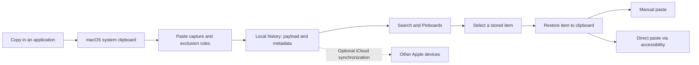

# How Paste works: evidence report

Inspection date: 9 October 2026 (Asia/Singapore). Scope: the installed macOS Paste application, its visible behavior, local storage structure, and official product documentation. PasteNow is a separate installed application and is excluded from the conclusions below.

Paste extends the system clipboard with a searchable history. It captures copied content while running, applies exclusion rules, retains the content and metadata, and lets the user select an older item for reuse. Direct pasting additionally sends a paste shortcut to the receiving application. Optional iCloud synchronization distributes history and Pinboards across devices.

## Evidence and confidence

| Finding | Evidence | What it establishes |
|---|---|---|
| Installed version is 6.0.3, build 14117 | Local `Info.plist`, [installation evidence](evidence/installation.json) | Version of the inspected bundle, not the latest available version |
| Startup and background operation enabled; sound disabled | [General settings screenshot](evidence/general.png) | Current visible configuration |
| Search can retrieve earlier copied text | [Filtered history screenshot](evidence/history-search.png), [accessibility snapshot](evidence/history-search-ax.txt) | Both synthetic markers were available together after clipboard changes |
| Local history uses a SQLite store with Core Data conventions | [Schema and aggregate counts](evidence/storage-summary.json) | Actual storage layout, without exporting clipboard contents |
| Confidential/transient filtering and app exclusions enabled | [Rules screenshot](evidence/rules.png) | Configured filters; not a test of every sensitive-content case |
| Direct paste is selected | General settings screenshot; [official direct-paste explanation](https://pasteapp.io/help/paste-directly-to-other-applications) | Selected mode and documented mechanism; successful delivery to TextEdit was not confirmed |
| iCloud is unavailable in the visible UI | General settings screenshot | Current UI status, not a diagnosis of the cause |

## Capture, search, and reuse

The functional flow is:

This diagram combines observed storage/UI behavior with the vendor's documented flow; it is not recovered source code.

On Mac, capture runs in the background and supports text, links, images, files, and colors. Closing the window does not stop capture. The official documentation describes confidential and temporary-content exclusions and notes that formatting is retained by default. [Official capture documentation](https://pasteapp.io/help/what-paste-captures)

The inspected keyboard settings show Shift–Command–V to open Paste, Command–Left/Right to switch Pinboards, Command with 1–9 for Quick Paste, and Shift for plain-text mode. Paste Stack has no assigned activation shortcut in this configuration. [Shortcut settings](evidence/shortcuts.png)

The UI presents history as cards with content previews, item type, relative time, and character count. Named Pinboards provide another way to organize saved items. Search filters the visible cards: searching `PASTE-RESEARCH-20261009` returned both test strings ending in `-A` and `-B`.

The controlled UI exercise used a new TextEdit document, entered and copied A, replaced it with B and copied again, then opened Paste and searched. Both markers appeared in history. This confirms retrievability across clipboard changes. Automation may itself use clipboard transport, and one inspected card displayed a Chrome source icon. Therefore, this exercise does **not** isolate exactly which input operation created each record or prove accurate source attribution.

Attempts to activate A did not produce a visibly populated TextEdit field. Direct-paste delivery remains unverified; no permission settings were changed. The official explanation says Paste restores clipboard content and sends Command–V to the foremost application using Accessibility access. Without that access, selecting an item for reuse still allows manual pasting. Paste Stack may also send Command–C. [Official direct-paste documentation](https://pasteapp.io/help/paste-directly-to-other-applications)

## Local storage and implementation clues

The inspected data directory is:

`/Users/ronny/Library/Containers/com.wiheads.paste/Data/Library/Application Support/Paste/`

| Component | Observed structure |
|---|---|
| `db.sqlite` | 91,430,912 bytes, about 87.2 MiB |
| `.db_SUPPORT/_EXTERNAL_DATA/` | 470 files totaling 348,550,940 bytes, about 332.4 MiB |
| `ZITEMENTITY` | 3,082 rows; type, checksum, title, timestamps, preview, source-app/device/list references |
| `ZITEMDATAENTITY` | 3,082 rows; `ZRAWPASTEBOARDITEMS` payload field |
| `ZAPPLICATIONENTITY` | 115 rows; bundle identifier, name, color, icon |
| `ZDEVICEENTITY` / `ZLISTENTITY` | 1 device row and 5 list rows |
| Cloud-related schema | Change tokens, object changes, pending mappings, shares, and CloudKit record fields |

Counts are a snapshot, not an estimate of the exact number of cards currently shown. Database and external files together total about 419.6 MiB, excluding WAL, SHM, caches, and other support files. External files were counted and sized, not decoded; their precise payload types remain unverified.

The `Z_` tables and metadata tables strongly indicate a Core Data SQLite backing store. Separating item metadata from raw pasteboard payloads explains how Paste can show previews and source context while retaining reusable clipboard representations. The exact serialization, compression, search indexing, deduplication rules, and transaction logic were not established.

Static binary strings include `NSPasteboard`, `changeCount`, and CloudKit-related names. These support clipboard integration and a CloudKit synchronization implementation, but strings alone cannot establish the capture loop, polling interval, or executed code path. [Binary evidence](evidence/binary-clues.txt)

The bundle is marked `LSUIElement=true` and includes `Library/LoginItems/Paste Helper.app` with identifier `com.wiheads.paste.mac-helper`. This is consistent with menu-bar/background operation and login support. The helper's exact runtime responsibilities were not traced.

Two restricted marker searches—one in `ZTITLE`, another for marker bytes in `ZRAWPASTEBOARDITEMS`—returned no matches in the inspected database. The UI evidence therefore proves visible history/search, but does not prove that these markers were persisted in this particular store. Encoding, deferred persistence, or another store could explain the gap; none was verified. [Marker query result](evidence/marker-database.json)

## Retention, synchronization, and privacy

The visible retention slider is at one month. Official documentation states that older unpinned history expires according to the selected duration, while pinned items and Pinboards are retained. Available durations are a day, week, month, year, or forever. Expiration and deletion were not exercised. [Official retention documentation](https://pasteapp.io/help/control-history-retention)

The Rules panel has Ignore confidential content, Ignore transient content, and Generate link previews enabled. Passwords and Keychain Access are excluded applications. The UI warns that link previews can affect one-time or analytics-sensitive links. Link-preview network requests were not traced.

Sensitive-content detection is conditional: the vendor explicitly notes that some password-manager browser extensions copy in ways Paste cannot recognize. Enabled filtering should not be interpreted as a guarantee that all secrets are excluded. [Official exclusion documentation](https://pasteapp.io/help/exclude-apps)

The stored preference `enable-sync` is true, but the UI shows iCloud unavailable with its switch disabled/off. The inspected CloudKit object-metadata and change-token tables both contain zero rows. These observations establish a difference between saved intent and current UI availability; they do not prove that synchronization is operating, identify its failure cause, or establish whether cloud data exists.

The vendor states that history and Pinboards live locally and optionally in the user's private iCloud account. Its privacy policy separately describes usage analytics through PostHog and crash reporting through Sentry. Thus, the statement about clipboard content staying local/private-iCloud is not a claim that the application makes no external network requests. These are vendor policy statements, not independently verified traffic findings. [Data location](https://pasteapp.io/help/where-paste-stores-your-data), [Privacy policy](https://pasteapp.io/privacy)

On iPhone, the same continuous background-capture model does not apply: Paste captures when opened or through its keyboard/share extensions. iPad capture can operate while Paste is visible alongside another app. These are documented platform differences, not device tests performed here. [Capture documentation](https://pasteapp.io/help/what-paste-captures)

## Investigation limits

This report establishes the installed bundle identity, visible settings, searchable synthetic history, and local database structure. It does not establish successful direct paste, live cross-device sync, network destinations, exact capture timing, local encryption, or the cause of earlier clipboard/audio symptoms.

Process listing was denied by the environment. Entitlement inspection emitted an invalid-entitlements warning, so no conclusion about effective sandbox privileges is drawn from it. Clipboard settings, retention, permissions, and existing history were not deliberately changed or deleted. The synthetic markers may remain in history, and TextEdit automatically assigned a document URL during the exercise.

Earlier memory was used only to distinguish Paste from PasteNow and avoid treating past audio observations as current evidence. No historical root-cause claim is carried into this report.
